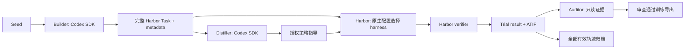

# 当前架构

设计在同一次 Builder 构建调用内完成，设计卡随 metadata 归档。轻量模式跳过 Distiller 和 Auditor。
审查模式在构建后统一审查设计卡、最终任务与指导。

## 模块职责

| 模块 | 职责 |
| --- | --- |
| contracts | 严格配置、交付与持久状态；无旧版迁移 |
| agents/runtime.py | 内部三角色的 SDK 调用、订阅或 API 认证、交付修复和本地执行事件；API 直连外部服务 |
| agents/harbor.py | 原生配置快照、单 Trial 子进程、取消/超时、ATIF 与 Trial 结果 |
| agents/process.py | Harbor 与预热共用的有界进程组终止 |
| agents/seed_environment.py | 与 harness 无关的环境预热和 Docker daemon 间镜像转移 |
| agents/task_environment.py | 运行副本使用预热镜像，正式任务保持可移植 |
| verification/harbor_task.py | 完整 Task、环境来源、原生自测结果和指纹的静态验证 |
| workflow/factory.py | 统一候选状态机、有限修订、指导投影和 Attempt 恢复 |
| workflow/batch.py | 固定 Seed 槽位的生成与采集调度 |
| export | 完整 Task 导出与基于 ATIF 的训练/诊断记录 |

## 关键边界

SAF 不知道任意 harness 的模型协议、安装方式或认证。`agents`、`environment`、`verifier` 等原生字段由
Harbor 解释；只允许一个 agent，因为一个 SAF Attempt 对应一个 Trial。
多次尝试由 SAF 预算控制，Harbor `retry.max_retries` 固定 0。

配置文件本身被冻结并校验摘要。Harbor 工作目录保留原配置目录，外部资源内容及环境变量没有快照。
修改冻结配置快照、内部执行参数或任务指纹会使恢复显式失败，不能混合不同 harness 或不同任务的结果。

SDK 工作区的 inputs 为暂存材料；Builder 持久线程限于同候选，Distiller 修订用新线程和脱敏反馈。
Harbor 只接收任务与授权指导；当前 solution/tests 的隔离由 Harbor 执行。确定性 ATIF 检查只检查工具输入，
Auditor 再审查语义。宿主 full-access 是受信任 Worker 边界，不是操作系统安全沙箱。

结果与 checkpoint 原子写入；恢复可接管已完成的 staging 结果，不重新 rollout。
Job 与 Batch 使用单写者文件锁；取消等待 worker 和 Harbor 子进程组退出。
批次中的失败任务保持身份，不创建替代 Seed。

默认 audited，Harbor 示例选择 codex。无有效轨迹的失败也进入 Auditor diagnosis；只有真实完成审查才标记 reviewed。
诊断不能 accept，reject 停止候选；审查失败恢复只重审，不重复执行 Solver。
