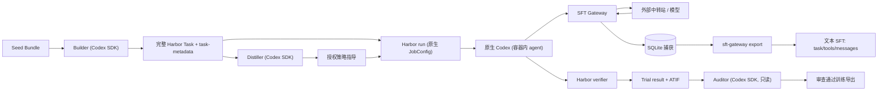

# SAF 与 SFT Gateway：架构、输入输出与使用指南

本文描述两个相邻系统的真实实现与接入方式：

- **SAF（Science Agent Factory）**：把科学任务 Seed 合成完整 Harbor Task，交给 Harbor 执行 Solver，并归档、审核轨迹。
- **SFT Gateway**：一个 OpenAI 兼容的采集代理，夹在 harness（原生 Codex）与外部计费中转站之间，透明转发并记录模型请求/响应，按可证明的因果前缀重建多轮轨迹，导出文本 SFT。

目标读者：需要在本机部署、接入、排障或二次开发的维护者。文中路径均为当前工作区实际路径。

---

## 1. 整体数据流

### 1.1 宽链路



### 1.2 两条认证链路（关键）

| 链路 | 谁发起 | 认证 | 端点 |
| --- | --- | --- | --- |
| 内部三角色（Builder / Distiller / Auditor） | SAF 直接调 Codex SDK（`AsyncCodex`） | `SAF_CODEX_API_KEY`（`codex.auth_mode: api_key`） | `SAF_CODEX_BASE_URL`（直连外部 Responses API） |
| Harbor rollout（Solver） | Harbor 容器内原生 Codex | 容器只拿到 **gateway key**（`SFT_GATEWAY_API_KEY`） | `http://<gateway_host>:<port>/runs/<run_id>/v1` |
| Gateway → 上游 | Gateway 自身 | `SFT_UPSTREAM_API_KEY`（计费 key，绝不进容器） | `SFT_UPSTREAM_URL` |

因此：**内部角色的请求不会出现在网关捕获里；网关只记录 Harbor rollout 的 Solver 轨迹。** 若想让内部角色也留 HTTP 记录，需自行把它们指向网关（不是默认设计）。

---

## 2. SAF：职责、模块与输入输出

### 2.1 系统职责

- 读入 `saf.seed.v2` Seed 清单，冻结原生 Harbor 配置与执行参数。
- 让 Builder 在**一次** Codex 调用内完成：设计卡 → 环境探索 → 完整 Harbor Task → 真实 Oracle=1/Nop=0 自测。
- 静态验证任务可移植性与自测证据；audited 模式下 Distiller 蒸馏策略卡、Auditor 预审与轨迹审核。
- 把任务交给 Harbor（SAF 不实现 harness、不选模型协议、不预装 harness），读回 Trial result 与 ATIF。
- 归档所有 Attempt，导出训练/诊断记录。

### 2.2 模块清单（职责 / 输入 / 输出）

| 模块 | 职责 | 输入 | 输出 |
| --- | --- | --- | --- |
| `cli.py` | CLI 入口 | argv、`--config`、`SAF_*` 环境变量 | `run/resume/status/export/batch-*/environment-*` 结果 JSON |
| `contracts/` | 严格配置、交付、持久状态模型 | YAML、JSON、环境变量 | Pydantic 校验后的对象；非法即抛错 |
| `agents/runtime.py` | 三角色 Codex SDK 调用、认证、交付修复、本地执行事件 | role、workspace、message、输出 Schema、thread_id | `AgentExecution`（含 thread_id、turn_ids、事件文件） |
| `agents/roles.py` | 组装三角色任务消息与交付边界 | 任务/Seed 标识、模式、路径 | 发往 SDK 的请求 JSON + 期望输出模型 |
| `agents/sdk_control.py` | 固定 SDK 0.147.0 的取消适配、心跳、软预算提醒、有界中断 | `AsyncCodex`、thread、turn 预算 | 原生 TurnResult / 进度事件 |
| `agents/harbor.py` | 冻结原生配置、跑单 Trial、回收进程组、读 ATIF/Trial | Harbor JobConfig、task_dir、attempt_dir、guidance | `RolloutResult`、`result.json`、`trajectory.json` |
| `agents/seed_environment.py` | Seed 环境预热缓存、跨 Docker daemon 传镜像 | Seed 清单、Dockerfile、配置 | `v2/registry.json`、预建镜像 |
| `agents/task_environment.py` | 运行副本引用预建镜像；正式任务保持可移植 | 源 task、缓存条目 | 注入 `docker_image` 的临时 task 副本 |
| `agents/process.py` | Harbor 与预热共用的有界进程组终止 | 子进程、grace | 终止结果 |
| `verification/harbor_task.py` | Task/环境来源/自测/fingerprint 静态验证 | task 根、metadata 根 | 通过或异常；`harbor_task_fingerprint` |
| `workflow/factory.py` | 统一候选状态机、有限修订、指导投影、Attempt 恢复 | settings、seed_dir、job_id | Job 状态 JSON、归档制品 |
| `workflow/batch.py` | 固定 Seed 槽位的生成与采集调度 | batch 配置、seed 根 | batch 状态 |
| `workflow/workspace.py` | Agent 隔离工作区、暂存 inputs/outputs、资源守卫 | job 根、role、run_id | workspace、清理结果 |
| `export/` | Harbor Task 导出、基于 ATIF 的训练/诊断记录 | job 目录 | 导出目录 |

### 2.3 候选状态机（`workflow/factory.py`）

```
PENDING → (_build) → BUILT
BUILT → (audited: _distill → _audit preflight) → PREFLIGHT_ACCEPTED
PREFLIGHT_ACCEPTED → (_rollout) → SOLVED
SOLVED → (audited: _audit final/diagnosis) → PREFLIGHT_ACCEPTED 或 CURATED
失败/超预算 → FAILED
```

- 失败分类：`contract`（交付/结构）、`infrastructure`（网络/限流）、`semantic`（审查拒绝）。
- 恢复保证：`state.json` 原子写；相同 `harbor.yaml` 摘要与 `settings_sha256` 才允许 resume；已完成的 attempt 不重跑。

---

## 3. SFT Gateway：职责、模块与输入输出

### 3.1 系统职责

- 只白名单转发 `responses`、`chat/completions`、`models` 端点；校验最终 origin，不跟随重定向。
- 每个请求先持久化再转发；响应以短事务写入 SQLite，可选 JSONL 镜像。
- 从捕获中恢复可确认完成的 response，建因果父边（显式 `previous_response_id` 优先，否则同 run/session 的前缀匹配），每个叶形成一条轨迹。
- 资格检查（父链、静态配置、工具闭合、文本类型、可观测监督来源）后投影为固定 schema 的文本 SFT。

### 3.2 模块清单

| 模块 | 输入 | 输出 / 功能 |
| --- | --- | --- |
| `config.py` | 环境变量 / 覆盖参数 | 不可变 `GatewayConfig`，key 不进 repr |
| `app.py` | 原生请求、上游响应 | 认证、白名单转发、终态捕获、管理/导出 API |
| `gateway/detection.py` | path/headers/body | Chat 或 Responses 协议选择 |
| `gateway/session.py` | path/header/metadata | run/session 作用域解析、脱敏 headers；**不按计费 key 分组** |
| `gateway/storage.py` | 请求、事件、终态 | SQLite 短事务、只读快照、JSONL 镜像 |
| `sse.py` | 分片 bytes | 有界有序 SSE 帧 |
| `protocols/responses.py` / `responses_state.py` | Responses 请求/SSE | 有序 item 上下文、父响应 ID、按索引累积快照 |
| `protocols/chat.py` | Chat 请求/响应 | 有序 message 上下文 |
| `protocols/compatibility.py` | 原始 bytes/JSON | 可选剥离 Codex 内部元数据的转发正文 |
| `trajectory/prefix.py` | 两个 JSON 序列 | 类型敏感精确前缀 |
| `trajectory/conversation_index.py` | 拓扑排序的 completion | 分支图，每叶一条轨迹 |
| `export/validation.py` | 有序 tool calls/results | pending/孤立/类型错误/并行状态 |
| `export/eligibility.py` | 一条轨迹 | 统一拒绝理由 |
| `export/codex.py` | 合格轨迹 | `task/tools/messages` 文本 SFT |
| `export/messages.py` | 轨迹 | 审计用逐轮 messages |
| `cli.py` | argv、捕获库 | `serve` / `run` / `export`；manifest、原始证据 |
| `scripts/run_harbor_via_gateway.sh` | task/env/runtime/image | 预检、起网关、跑 Harbor、离线导出 |
| `scripts/codex-runtime-launcher.sh` | Codex argv/env | exec 挂载的 0.153.4 二进制 |

### 3.3 HTTP 路由

| 路由 | 用途 |
| --- | --- |
| `GET /health` | 存活检查，返回 `instance_id` |
| `POST /runs/<run_id>/<path>` | **带显式分组的模型转发**（推荐，Harbor 用此路径） |
| `POST /<path>`（如 `/v1/...`） | 无显式 run 的转发，作用域靠 thread/session 头推断，缺失则 `unassigned` |
| `GET /runs`、`GET/POST /runs/<id>[/completions|/export]` | 管理 API（需 `SFT_ADMIN_API_KEY`） |

> 关键：`/runs/<run_id>/v1` 只改变 URL，不改变请求正文；同一个 run_id 不要分给无关任务。

---

## 4. 端到端阶段（单 Seed）

| 阶段 | 执行者 | 关键产物 |
| --- | --- | --- |
| 1. Seed 校验与配置冻结 | SAF | `factory/jobs/<job>/seed/`、`harbor.yaml`、`state.json` |
| 2. 构建内设计 | Builder（SDK） | `design_card.json` |
| 3. 环境探索/构建 | Builder | `exploration_report.json`、`environment_report.json`、`outputs/harbor-task/` |
| 4. 真实 Oracle/Nop 自测 | Builder + Harbor（临时副本） | `self_test.json`、两个原生 `result.json` |
| 5. 静态验证 | SAF | `build_result.json` 校验、task fingerprint |
| 6. 蒸馏与预审（audited） | Distiller + Auditor | `strategy.json`、preflight `audit.json` |
| 7. Solver rollout | Harbor + 容器内 Codex → Gateway | Trial result、ATIF `trajectory.json`、SQLite 捕获 |
| 8. 轨迹审核（audited） | Auditor | final `audit.json` / diagnosis |
| 9. 导出 | SAF `export` / gateway `export` | Harbor Task 归档 / `sft_samples.jsonl` |

---

## 5. Docker 容器与挂载（重点）

### 5.1 三类“容器/镜像”概念

| 类别 | 内容 | 谁负责构建 | 是否进正式任务 |
| --- | --- | --- | --- |
| **Seed 科学环境镜像** | Seed 的 `environment/`（Dockerfile + 数据 + 科学依赖） | `SeedEnvironmentCache` 预热 | 否，正式任务保持 `Dockerfile`/Compose 可移植 |
| **Task 环境** | Harbor Task 根下的 `environment/` | Builder（`synthesize`）或直接复用 Seed（`reuse_seed`） | 是（作为文件） |
| **Codex runtime** | 原生 Codex 二进制 | 外部提供 | 否，运行时只读 bind mount |

### 5.2 预建环境缓存与登记表

- 缓存根由 `seed_environment_cache.root` 指定，登记表在 `<root>/v2/registry.json`。
- 每个条目结构见 `SeedEnvironmentCacheEntry`（`agents/seed_environment.py:123`），字段**严格**（`extra="forbid"`）。
- 解析规则 `resolve(seed_id, environment_sha256)`（`seed_environment.py:272`）：
  - `status == "ready"` 且 `environment_sha256` 匹配且 `image_id` 非空；
  - `mode: require` 时若缺失/不匹配 → 直接抛错，不会退回现场构建。
- `environment_sha256` 是 Seed `environment/` 目录的 **tree digest**：按相对 POSIX 路径排序，对每个文件 `hash(路径、NUL、字节、NUL)`，不含宿主绝对路径。

当前 fullchain 登记表已包含并验证：

```
microarch-modeling  digest=06e16c41fcc2b67b…  image=saf/tb-science-seed:tb-science-v0.1-microarch-modeling-06e16c41fcc2b67b
                    image_id=sha256:43d763407f018e320aa8b16577b63a01c92fa4864f0dd198cdb90470d39d2969
```

### 5.3 `reuse_seed`：正式任务 vs 运行副本

`pipeline.environment_strategy: reuse_seed` 时：

1. **正式任务**：工厂在 Builder 调用前，把 `inputs/seed/environment/` 逐字节复制到 `outputs/harbor-task/environment/`；Builder 不得修改。metadata `environment_source=seed_copy` 并记录 digest。
2. **rollout 临时副本**：`prepare_cached_task()`（`agents/task_environment.py:62`）不改正式任务，而是：
   - 非 Compose：新建 `environment/Dockerfile`，内容为 `FROM <cached image>`；
   - Compose：复制源环境并把 `build` 替换为预建 `image` + `pull_policy: never`（含 sidecar 服务镜像）；
   - 向临时 `task.toml [environment]` 注入 `docker_image = "<cached image>"`。
3. `synthesize` 时则由 Builder 自包含环境，不注入预建镜像。

因此：**正式任务可移植（无 `docker_image`、无宿主路径），只有运行副本引用预建镜像。**

### 5.4 Harbor bind mounts

Harbor 原生配置的 `environment.mounts` 是真正的容器挂载点。当前 harness 的 `harbor.template.yaml`：

```yaml
agents:
- name: codex
  model_name: glm-5.3-flash
  env:
    OPENAI_BASE_URL: ${SCIENCE_ROLLOUT_URL}     # http://host:port/runs/<run_id>/v1
    OPENAI_API_KEY: ${SCIENCE_GATEWAY_KEY}      # 只把 gateway key 交给容器
  kwargs:
    reasoning_effort: low
    version: 0.147.0
verifier:
  disable: false
environment:
  mounts:
  - type: bind
    source: /data/hy/wenwu/science-agent-factory/var/smoke-20260918/codex-runtime-image/codex
    target: /usr/local/bin/codex
    read_only: true
    bind:
      create_host_path: false
```

独立脚本 `run_harbor_via_gateway.sh` 的挂载更完整：

```json
"environment": {
  "type": "docker",
  "mounts": [
    {"type":"bind","source":"<CODEX_RUNTIME>","target":"/opt/codex","read_only":true,
     "bind":{"create_host_path":false}},
    {"type":"bind","source":"<codex-wrapper>","target":"/usr/local/bin/codex","read_only":true,
     "bind":{"create_host_path":false}}
  ]
}
```

另外 `strategy_seed` 指导资产由 `HarborRunner` 自动追加只读挂载到 `/opt/saf-guidance`（`agents/harbor.py:178`）。Bind mount 必须写绝对 `source`，`create_host_path: false` 可避免静默创建空目录。

### 5.5 独立 Docker daemon（rootless）

预热与 rollout 可分离，避免 bridge/磁盘竞争：

```yaml
seed_environment_cache:
  build_docker_host:   unix:///run/user/1000/saf-build-docker.sock
  rollout_docker_host: unix:///run/user/1000/saf-docker.sock
```

- 两者不同时，`_transfer_image()` 用 `docker image save | load` **串行**把预建镜像从 build daemon 导入 rollout daemon（`seed_environment.py:558`）。
- Harbor rollout 与缓存可用性检查统一使用 `rollout_docker_host`（`HarborRunner` 设置 `DOCKER_HOST`）。
- Builder 角色会拿到 `build_docker_host`（`runtime.py:296`），否则用 rollout daemon。

### 5.6 实际命令

```bash
# 仅预检（不启动模型、容器、网关）
cd /data/hy/wenwu/science-agent-factory
.venv/bin/python var/science-fullchain-ready/run.py --check-only --seed tb-science-v0.1-microarch-modeling
# 输出: Preflight OK: Seed, cached image ID, gateway imports, Codex runtime and Harbor model routing

# 预热 Seed 环境（可选，已预热则命中）
.venv/bin/saf --config configs/local.yaml environment-prewarm <seed_root>
.venv/bin/saf --config configs/local.yaml environment-cache-status

# 直接检查预建镜像
DOCKER_HOST=unix:///run/user/1000/saf-docker.sock \
  docker image inspect saf/tb-science-seed:tb-science-v0.1-microarch-modeling-06e16c41fcc2b67b --format '{{.Id}}'
```

---

## 6. 模型如何指定（重点）

### 6.1 Gateway 本身不选模型

网关对模型名是**纯透传**：

- 请求 body 的 `model` 仅被记录（`app.py` 中 `model = body.get("model")`）；
- 转发使用原始/兼容处理后的 `wire_body`，**不改名、不映射、不重试计费请求**。

所以“指定模型”发生在**客户端**（Harbor 的 Codex agent 或 Codex 自身配置），网关只要求上游中转站支持该模型名。

### 6.2 Harbor rollout（Solver）模型

在原生 Harbor 配置的 `agents[0]`：

```yaml
agents:
- name: codex
  model_name: glm-5.3-flash          # 透传给上游的模型名
  kwargs:
    reasoning_effort: low            # 推理强度
    version: 0.147.0                 # Codex runtime 版本，须与挂载的二进制一致
  env:
    OPENAI_BASE_URL: http://<host>:<port>/runs/<run_id>/v1
    OPENAI_API_KEY: <gateway key>
```

- `reasoning_effort` 由 Harbor 的 Codex agent kwargs 控制。
- 完整模型名前缀（如 `bailian/...`）依赖本机 Harbor 的兼容补丁（`run.py:58` 会检查 `codex.py` 是否保留路由前缀）；否则会被 `split("/")[-1]` 截断。

### 6.3 SAF 内部角色模型

在 SAF `factory.yaml`（会与 wheel 内置 `default.yaml` 深合并）：

```yaml
agents:
  builder:
    model: gpt-5.6-luna
    reasoning_effort: medium
  distiller:
    model: glm-5.3-flash
    reasoning_effort: low
  auditor:
    model: glm-5.3-flash
    reasoning_effort: low
```

- 这些模型名进入 `CodexConfig` 的 `model_provider`/`model`，走 `codex.base_url`（`SAF_CODEX_BASE_URL`），**不经过 SFT Gateway**。
- 支持 `api_key` 与 `chatgpt_subscription` 两种模式；订阅模式会清空 API key/base_url，忽略自定义网关。

### 6.4 Gateway 环境变量

| 变量 | 作用 | 默认 |
| --- | --- | --- |
| `SFT_UPSTREAM_URL` | 外部中转站 base URL | `http://127.0.0.1:4000` |
| `SFT_UPSTREAM_API_KEY` | 上游计费 key（不进容器） | 无 |
| `SFT_GATEWAY_API_KEY` | 模型入口认证（给容器） | 无 |
| `SFT_ADMIN_API_KEY` | 管理/导出 HTTP API | 未设则禁用 |
| `SFT_DB` | SQLite 路径 | `data/gateway.db` |
| `SFT_INSTANCE_ID` | 本次实例标识（健康检查） | 无 |
| `SFT_STRIP_CODEX_INTERNAL_METADATA` | 剥离 Codex 内部元数据（兼容部分中转站） | `0` |
| `SFT_MODEL` | 仅 `run_harbor_via_gateway.sh` 用它填 Harbor `model_name` | `gpt-6-astra` |
| `SFT_REQUEST_TIMEOUT` | 上游 HTTP 超时 | 900s |
| `SFT_MAX_CONCURRENT_REQUESTS` | 每 worker 活跃请求上限 | 32 |

> 固定 `SFT_UPSTREAM_API_KEY` 时必须配 `SFT_GATEWAY_API_KEY`，否则拒绝启动。

### 6.5 run 分组

- 单 Seed harness 把 rollout URL 设为 `http://<host>:<port>/runs/<run_id>/v1`，导出时用同一 `run_id`。
- 网关也可从 thread/session 头自动分组；但显式 `/runs/<run_id>` 最稳，避免落到 `unassigned`。

---

## 7. 配置示例

### 7.1 SAF `factory.yaml`

```yaml
storage_root: ${SCIENCE_TEST_RUN_ROOT}/factory
allow_host_full_access: true
codex:
  auth_mode: api_key
  account_home: /home/hy/.codex
  turn_timeout_s: 5400
  turn_retries: 1
  base_url: ${SAF_CODEX_BASE_URL}
  retry_backoff_s: 5
harbor:
  executable: /data/hy/wenwu/science-agent-factory/.harbor-venv/bin/harbor
  config_file: ${SCIENCE_TEST_RUN_ROOT}/harbor.yaml
  wall_timeout_s: 3600
pipeline:
  workflow_mode: audited
  task_count: 1
  concurrency: 1
  environment_strategy: reuse_seed
  required_trajectories: 1
  max_solver_attempts: 2
seed_environment_cache:
  mode: require
  root: /data/hy/wenwu/science-agent-factory/var/science-fullchain-ready/cache
  build_docker_host: unix:///run/user/1000/saf-docker.sock
  rollout_docker_host: unix:///run/user/1000/saf-docker.sock
agents:
  builder:   {model: gpt-5.6-luna,  reasoning_effort: medium}
  distiller: {model: glm-5.3-flash, reasoning_effort: low}
  auditor:   {model: glm-5.3-flash, reasoning_effort: low}
```

### 7.2 Gateway 启动

```bash
cd /data/hy/wenwu/sft-gateway
export SFT_UPSTREAM_URL="$SAF_CODEX_BASE_URL"
export SFT_UPSTREAM_API_KEY="$SAF_CODEX_API_KEY"
export SFT_GATEWAY_API_KEY="$(python -c 'import secrets;print(secrets.token_urlsafe(32))')"
export SFT_DB="$PWD/data/gateway.sqlite"
export SFT_STRIP_CODEX_INTERNAL_METADATA=1
sft-gateway serve --host 0.0.0.0 --port 18119
# 或: python -m uvicorn sft_gateway.app:app --host 0.0.0.0 --port 18119
```

---

## 8. 运行方式

### 8.1 单 Seed 全链路（推荐入口）

```bash
cd /data/hy/wenwu/science-agent-factory
.venv/bin/python var/science-fullchain-ready/run.py \
  --seed tb-science-v0.1-microarch-modeling \
  --gateway-host 10.6.8.115 --gateway-port 18119
```

`run.py` 会：预检 → 起独立网关 → 运行 SAF → 停网关 → 导出 SFT → 写 `summary.json`，且**只关闭本次启动的网关**。当前默认 Seed 为 `tb-science-v0.1-microarch-modeling`。

### 8.2 批次

```bash
.venv/bin/saf --config configs/local.yaml batch-run <seed_root>
.venv/bin/saf --config configs/local.yaml batch-supervise <batch_id>
.venv/bin/saf --config configs/local.yaml batch-rollout <batch_id>
.venv/bin/saf --config configs/local.yaml batch-export <batch_id>
```

### 8.3 独立 Harbor + 网关（已有 task）

```bash
SFT_ENV_FILE=/path/to/trusted.env \
SFT_PREWARMED_TASK=/path/to/prepared-task \
SFT_CODEX_RUNTIME=/path/to/codex-runtime-0.1534 \
SFT_MODEL=glm-5.3-responses \
bash scripts/run_harbor_via_gateway.sh /path/to/task
```

该脚本要求：`task.toml` 已指定预热 `environment.docker_image`；`SFT_PREWARMED_IMAGE`（若设）必须与之一致，否则拒绝启动；`task/metadata` 不下载不构建。

### 8.4 导出

```bash
# 网关：按会话导出
python -m sft_gateway.cli export <run_id> --db <db> --output dataset --task <task> [--include-incomplete]

# SAF：导出自有归档
saf --config configs/local.yaml export <job_id> --format harbor
saf --config configs/local.yaml export <job_id> --format tool-sft [--selection all]
```

---

## 9. 输出制品与成功判定

### 9.1 SAF

| 路径 | 内容 |
| --- | --- |
| `factory/jobs/<job>/state.json` | 状态机、stage、错误 |
| `factory/jobs/<job>/candidates/<c>/revisions/<run>/` | 任务与 metadata |
| `factory/jobs/<job>/candidates/<c>/attempts/<a>/` | Harbor 原始制品、`trajectory.json`、`result.json` |
| `factory.log` | 工厂日志 |

### 9.2 Gateway

| 文件 | 用途 |
| --- | --- |
| `sft_samples.jsonl` | 正常训练集 |
| `sample.json` / `sft_samples.pretty.json` | 可读版本 |
| `sft_samples.incomplete.*` | 仅被拒投影（需 `--include-incomplete`），**不得混入正常训练** |
| `provenance.json` | 每条消息来源、父链、拒绝理由 |
| `export_report.json` | 统计（注意 `samples` 是请求轮数，不是 SFT 条数） |
| `manifest.json` | 导出文件 SHA-256，消费前校验 |

### 9.3 成功不等于 reward=1

- Harbor `verifier.reward=1`：任务被 Solver 解出。
- Gateway `eligible=true`：符合文本 SFT 投影契约。
- Auditor accept：语义审查通过。
- 三者独立判断；只有同时满足才进入默认训练导出。

---

## 10. 边界与常见坑

1. **登记表严格字段**：`SeedEnvironmentRegistry`/`CacheEntry` 是 `extra="forbid"`。若直接把 smoke 缓存条目（含 `runtime_profile` 等额外字段）拷进 fullchain 登记表，`resolve()` 会抛 `ValidationError`，Job 立即 `pending` 失败。只保留条目模型声明过的字段。
2. **正式任务不可写 `docker_image`**：只有 rollout 临时副本注入；正式任务保留 `Dockerfile`/Compose 才可移植。`verification/harbor_task.py` 会拒绝宿主绝对路径、`~`、凭据等。
3. **容器内 `127.0.0.1` 指向容器自身**：网关地址必须是容器可达的宿主 IP / 服务名，不能是 `0.0.0.0` 或 `127.0.0.1`。
4. **上游 key 绝不进容器**：只传 gateway key；管理 key 也不传容器。
5. **SAF 内部角色不落网关捕获**：想让它们留痕需显式接入（改了认证拓扑）。
6. **每 5 分钟轮询式 `sleep`**：Codex SDK 侧若把长任务当作需要轮询，会产生大量 sleeper；这是耗时/日志噪声的常见来源，应优先用 `stop_when`/宿主 barrier 而非轮询。
7. **重算力 Seed**：如 `sparse-network-assimilation` 的 Oracle 是 4D-Var 多重打靶，自测可能数十分钟；换轻量 Seed（`microarch-modeling`、`virtual-baseline-localization`）可显著缩短全链路。
8. **Harbor 版本与挂载二进制必须一致**：`run.py` 会校验 `codex-cli 0.147.0`；独立脚本校验 `0.153.4`。混用会直接拒绝启动。
9. **一个 Attempt 只有一条轨迹**：Harbor `retry.max_retries` 被固定为 0，多次尝试由 SAF 预算控制。
10. **`unassigned` 不是任务**：没有身份线索时不要把共享 key 下的请求强行合并。

---

## 附：关键文件索引

- SAF 入口：`src/science_agent_factory/cli.py`、`var/science-fullchain-ready/run.py`
- 工作流：`workflow/factory.py`、`workflow/batch.py`、`workflow/workspace.py`
- 角色与运行时：`agents/roles.py`、`agents/runtime.py`、`agents/sdk_control.py`
- Harbor 与容器：`agents/harbor.py`、`agents/seed_environment.py`、`agents/task_environment.py`
- 契约：`contracts/settings.py`、`contracts/models.py`、`contracts/deliveries.py`、`contracts/state.py`
- 网关：`sft_gateway/app.py`、`config.py`、`gateway/session.py`、`gateway/storage.py`、`export/codex.py`、`cli.py`
- 说明：`docs/architecture.md`、`docs/task-building-workflows.md`、`../sft-gateway/ARCHITECTURE.md`、`../sft-gateway/SKILL.md`