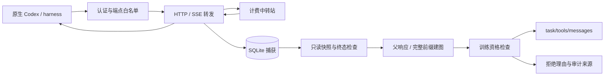

# SFT Gateway 架构与算法契约

版本 0.3.2。本文描述实际实现。训练格式由根目录 `sample.json` 约束；不输出 token ID、logprob 或 RL loss mask。

## 数据流



核心对象分为三层：不可改写的观测记录、可解释的因果父边、满足固定 schema 的训练投影。不能用同一任务、相同 prompt 或工具 ID 已配对来替代后两层检查。

## 模块输入输出

| 模块 | 输入 | 输出与主要功能 |
|---|---|---|
| `config.py` | 环境变量/覆盖参数 | 不可变配置，key 不进入 repr |
| `app.py` | 原生请求和上游响应 | 认证、白名单转发、终态捕获、管理导出；模块导入无 DB 写入 |
| `gateway/detection.py` | path/headers/body | Chat 或 Responses 协议选择 |
| `gateway/session.py` | path/header/metadata | run/session 作用域和脱敏 headers，不以计费 key 分组 |
| `gateway/storage.py` | 请求、事件、终态 | SQLite 短事务存储、一致只读快照、可选 JSONL 镜像 |
| `sse.py` | 分片 bytes | 有界、有序 SSE 帧，不判断模型完成 |
| `protocols/base.py` | 协议适配器实现 | context/target/ID 提取接口 |
| `protocols/chat.py` | Chat request/response | 有序 message context/target |
| `protocols/responses.py` | Responses request/response | 有序 item context/target 和父响应 ID |
| `protocols/responses_state.py` | Responses SSE events | 按索引累积响应快照、文本/推理/tool 参数 |
| `protocols/compatibility.py` | 原始请求 bytes/JSON | 可选去 Codex 内部元数据的转发正文 |
| `trajectory/models.py` | 完成记录、父边、资格问题 | Completion/Trajectory 数据结构 |
| `trajectory/context_fingerprint.py` | 协议、模型、request | 静态训练配置指纹，不是身份或任务证明 |
| `trajectory/prefix.py` | 两个 JSON 序列/候选 | 类型敏感精确前缀；低层 prompt-only 查询保留供独立使用 |
| `trajectory/conversation_index.py` | 已拓扑排列的 completion | 不可回写历史的分支图，每叶一个轨迹 |
| `export/validation.py` | 有序工具 calls/results | pending、重复/孤立/类型错误、并行状态 |
| `export/eligibility.py` | 一条轨迹 | 统一拒绝理由；空集合代表文本 SFT 合格 |
| `export/codex.py` | 合格轨迹或显式调试开关 | 用户指定 `task/tools/messages` 文本格式 |
| `export/messages.py` | 轨迹 | 审计用途的逐轮/整条 messages，不代替严格训练导出 |
| `cli.py` | argv 与捕获库 | serve/run/export；manifest、base64 原始证据、消息来源映射 |
| `scripts/run_harbor_via_gateway.sh` | task/env/runtime/image | 预检、网关、Harbor、离线导出及退出码 |
| `scripts/codex-runtime-launcher.sh` | Codex argv/env | exec 挂载的 0.153.4 二进制，不修改请求协议 |

所有生产模块、类和函数都有 docstring。边界判断和持久化副作用在相应函数中说明。

## HTTP 与凭据

只转发允许的 responses、chat/completions、models 端点。重复上游 base leaf 的兼容处理完成后才匹配白名单，再校验最终 origin。HTTPX 不跟随重定向；客户端不能把路径转换成外部绝对 URL 并获取计费凭据。

固定上游 key 必须配 gateway key。admin key 缺省禁用管理 HTTP API。认证、cookie、hop-by-hop 和 Connection 指定的 headers 不落入转发/常规 header 档案；上游 Authorization 单独构造。正文不自动扫描/改写，用户消息本身可能包含敏感业务数据，因此管理与文件访问需要受控。

模型请求默认保留 bytes；兼容变换开启时保存接收和转发两份正文。响应 bytes 是 HTTPX 解压后的数据，不是 TCP 报文。查询串用于实际转发，但不持久化，避免记录 query 中凭据；这意味着归档不能逐字节重放完整 HTTP 请求。

非流式 Responses 要求明确 completed；Chat 要求自然 finish_reason。SSE 的 DONE 只结束传输，不能把 length/content_filter 或矛盾状态升级为成功。只有明确完成事件及完成快照才可恢复已收到终态后断开的 Responses。实时捕获与离线重放共用终态合并逻辑。Chat 流若包含多个 choice 或当前不支持的扩展字段，会保留拒绝标记，不能因快照只投影首个 choice 而误进入训练集。

内容块类型在记录入口校验；事件累积的类型、索引等解析错误按记录隔离，报告 `invalid_response_events`，不拖垮其他任务导出。内容索引只允许已有位置或紧接末尾，防止不可信索引分配巨量占位。在线语义解析失败会标记采集失败并继续保存、转发原始 SSE；网络中断、大小上限和持久化失败仍可能终止传输。

## 并发和持久化

`requests` 保存 run 内序号、路径、时间和请求 JSON；`responses` 保存单次终态；`stream_events` 保存请求内帧序号和 bytes；v3 `request_wire` 保存接收/转发正文。旧库读取不迁移、旧 wire bytes 返回 unavailable。显式写模式迁移前创建 SQLite 一致备份，备份已存在时拒绝重复迁移以免覆盖。

每个写入是短事务，事件完成提交后才继续取上游数据。HTTP 层使用 AnyIO 线程执行持久化，取消保护让已经开始的操作完成；活跃 HTTP 请求上限约束等待工作量。没有另建丢弃事件的后台队列，也不依赖“累计 32 帧”才能释放写锁。多连接序号由 BEGIN IMMEDIATE 和唯一约束共同保护。

读出 request/response/events 处于同一个 SQLite 读事务，得到稳定快照。在线导出计算也在线程中执行。SQLite 写操作仍串行化，不是无限吞吐；每 worker 的并发上限不是所有进程的全局限额。

## 因果图算法

1. 从捕获记录恢复可确认完成的 response，提取 observed context/target。
2. 分两遍建图：第一遍解析显式父边并展开有效上下文；第二遍关闭重复展开，在依赖已满足的节点中逐次选取最短有效上下文，再建立前缀边。这样显式增量请求可以接在完整历史请求之前，不受数据库返回顺序影响。缺失父 ID、重复 ID、循环均保留原因，不能作为正常训练链。
3. 有 `previous_response_id` 时使用精确父节点。Responses input 是增量，即使包含与旧消息相同的内容也不自动去重。父 request instructions 不属于持久化历史；先去除父 preamble，再加入本轮 preamble。指令或静态配置变化保留谱系，但不导出一条静态配置的完整 SFT。
4. 无显式父边时，只在同 run/native-session/protocol 作用域搜索。必须有候选完整 `context + target` 出现在当前输入开头，再选最长证据。相同 prompt、不同答案的重试可以由实际答案消歧；相同完整证据的重试选稳定代表，原始记录仍全部保留。
5. 每个节点复制数据，旧节点可分叉。每个叶形成根到叶轨迹，后续加入不改写已返回的对象。

前缀比较忽略 Responses 顶层传输 id/status 及明确的空 annotations；业务嵌套字段保留。JSON 比较类型敏感。仅合法、无重复键的 function arguments 忽略序列化空白与键顺序；custom tool input 不做 JSON 解析。密文 reasoning 不假设不同 ciphertext 等价。

当前没有服务端 conversation/item reference 展开，也没有密文解密。没有身份且没有父 ID 的独立原生请求不能保证恢复任务归属。孤立根内已有 assistant 历史属于未观测监督来源，默认拒绝。

## 异步工具与监督来源

允许如下观测序列：

```text
assistant call A, call B, call C
result A
assistant call D
result C, result B
result D
assistant final
```

不把 B/C 的结果移动到第一次调用后。校验器沿叶快照遍历并用 call_id 管理 pending；任何时点可以有多个未决调用，导出时才要求全部闭合。并行情况下 ID 放进文本 schema 的 tool_call/tool_response content。

训练资格还要求每个 assistant/call/reasoning item 的位置属于某个实际响应 target，且各轮有效 context+target 在叶快照中保持。这样不会把客户端重发或手工插入的 assistant 文本自动当作网关观测的监督目标。

`provenance.json` 保存每条导出消息的叶 item 下标、投影内子位置、源 request/target 或有效 context 位置。请求数组中的顺序是可见因果证据；工具进程内部的启动/完成时间不在网关观测范围内。

## 资格与投影

默认检查：父链、静态模型/配置、工具结构和闭合、支持的文本类型、可观测监督来源、非空可见目标。compaction、未知关键 item、图片/文件等未支持输入、多候选 Chat 和隐式服务端 conversation 都不静默投影为正常训练数据。

文本投影保留正文、调用和结果次序。developer→system、reasoning 文本包装、忽略密文/部分元数据是明确的格式转换。摘要与正文不重复拼接，不把 opaque ciphertext 伪造成推理。Chat 扩展 reasoning 暂不承诺完整支持，原始记录保留。

只读取叶 context+target，不把每轮完整请求反复拼接。严格资格过滤在投影前执行；低层 `trajectory_to_codex_sample` 是投影函数，直接调用时调用者负责资格判断。

## 发布与可重复读取

导出使用同一 DB 快照，正常集与拒绝集分开。先在临时目录生成所有输出，再替换文件，最后发布包含全部校验和的 manifest。下游只接受 manifest 存在且所有摘要一致的文件集合；写入中断时不能误认半套输出为已完成发布。旧 convenience/debug 文件会清理。一个输出目录只应有一个导出进程。

## 与 Polar 的关系

参考 Polar stable `6a1ead6bfac054fce6c1e62d1a77b330d96c58db` 的 `src/polar/trajectory/builder/prefix_merging.py` 与 `gateway/completion_writer.py`。

Polar 用服务端 prompt tokens 分组，在 finalize 中保留采样 response tokens，用 EOT 定位 canonical interstitial，并保留 RL loss mask/logprob。本项目获取不到这些 token 证据，因此参考其“前缀分组、原始响应、插入工具结果”的思路，采用 message/item 级证据和拒绝规则，不能宣称等价复刻 token 算法。

Polar 的有界后台写盘允许将副本写盘失败与内存权威状态区分；本项目以 SQLite 为权威，因此采用等待提交的背压而非丢弃帧。独立回归和历史反例证明当前实现的具体边界，不能继承上游项目的全部生产保证。
